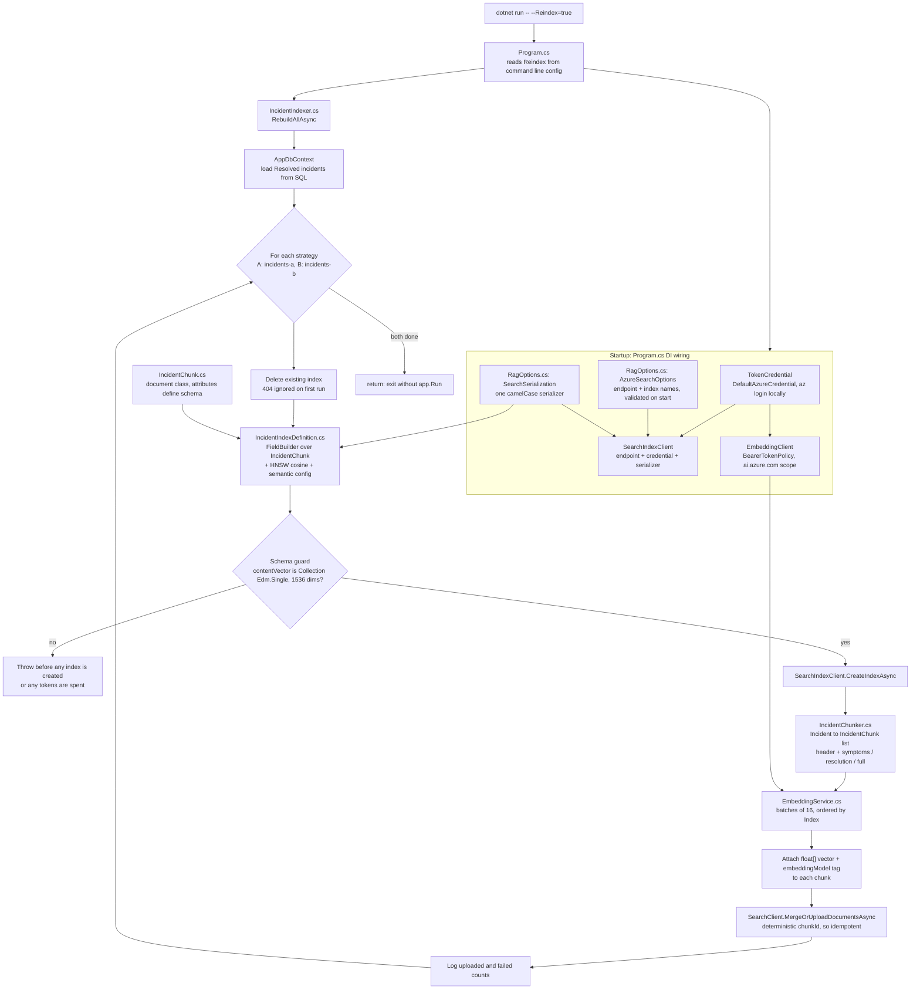

`# AI Incident Assistant Lite — Build Journal

> How to use this: after each 30-min block (or whenever something notable happens), add a short entry. Write commands as you actually ran them, not as the docs say. Future-you reading this before an interview is the audience.

---

## Environment

| Tool | Version | Notes |
|---|---|---|
| .NET SDK | 10.0.301 | |
| dotnet-ef | 10.0.11 | installed as global tool |
| Node | 22.4.1 | |
| Docker | 27.5.1 | |
| Azure CLI | 2.90.0 | via Homebrew |
| SQL Server | 2025 (container `sql2025`, port 1433) | official mcr image, runs natively fine |
| Editor | VS Code + C# Dev Kit | |

---

## Decisions Log

Record *why*, not just *what*. This is interview gold.

| Date | Decision | Why | Alternatives considered |
|---|---|---|---|
| 2026-09-06 | SQL Server 2025 in Docker over Postgres/Azure SQL | Matches resume + target roles; container ran clean on my machine | PostgreSQL (ARM-native, smoother locally), Azure SQL free tier (fallback) |
| 2026-09-06 | CLI scaffolding over VS Code GUI | Precision (--use-controllers), repeatable, scriptable | C# Dev Kit New Project command |
| 2026-09-06 | Plain model deployment over Foundry Agent | API calls model directly via SDK; simpler, cleaner story | Foundry Agents (unneeded orchestration) |
|  |  |  |  |

---

## Day 1 — API, Auth, APIM

### 
### Block 1 — Scaffold
- [x] Done
- **What I did:** Created solution + webapi project with controllers, added Scalar
  as the API reference UI, set up Models/DTOs/Services/Data folders, verified the
  sample endpoint end to end in the browser.
- **Commands that mattered:**
  - `dotnet new webapi -n IncidentAssistant.Api --use-controllers` (flag needed on
    .NET 10, otherwise you get the minimal API template)
  - `dotnet add package Scalar.AspNetCore` + `app.MapScalarApiReference()` in Program.cs
  - `dotnet new gitignore` (covers bin/, obj/, dev appsettings)
- **Surprises / gotchas:** .NET 10 templates no longer ship Swagger UI (dropped in
  .NET 9) — only the OpenAPI document is generated. Scalar at `/scalar` is the
  replacement for browser-based endpoint testing.
- **Time actually taken:** ~30 min
###  Block 2 — EF Core + database
- [x] Done
- **What I did:** Created the `Incident` entity with `Severity` and `IncidentStatus`
  enums, `AppDbContext` with model config + 3 seeded incidents, wired the connection
  string to the `sql2025` container, registered the DbContext in Program.cs, ran the
  first migration, and verified the rows exist via sqlcmd inside the container.
- **Commands that mattered:**
  - `dotnet add package Microsoft.EntityFrameworkCore.SqlServer` (+ `.Design`)
  - `dotnet ef migrations add InitialCreate`
  - `dotnet ef database update`
  - Verify: `docker exec -it sql2025 /opt/mssql-tools18/bin/sqlcmd -S localhost
    -U sa -P '<pw>' -C -Q "SELECT Title, Severity, Status FROM IncidentDb.dbo.Incidents"`
- **Key design choices:**
  - Enums stored as strings via `HasConversion<string>()` — human-readable rows,
    at the cost of a few bytes vs int storage
  - Seed data via `HasData` must be deterministic (hardcoded Guids/dates baked
    into the migration — `Guid.NewGuid()` here would make every migration see
    "changed" data)
  - Connection string lives only in `appsettings.Development.json` (gitignored),
    never in `appsettings.json`
- **Surprises / gotchas:**
- **Time actually taken:**
### Block 3 — CRUD
- [x] Done
- **What I did:**
- **Scoped DI lifetime** — `AddScoped<IIncidentService, IncidentService>()` means
  one instance per HTTP request: everything in one request shares that instance,
  the next request gets a fresh one. Chosen because the service depends on
  AppDbContext, which is itself scoped (a DbContext is a unit of work, not
  thread-safe, must not live across requests). The trio: Transient = new every
  resolve, Scoped = per request, Singleton = one for app lifetime.

- **JsonStringEnumConverter** — added via AddJsonOptions. Without it enums
  serialize as their underlying numbers (`"severity": 2`); with it they become
  strings (`"severity": "High"`), both in responses and when parsing request
  bodies/query params. Pairs with `HasConversion<string>()` on the EF side:
  enums are human-readable in JSON *and* in the database rows.

- **CancellationToken** — a cooperative "stop signal" threaded through async
  calls. ASP.NET Core creates one per request and cancels it if the client
  disconnects (closed tab, timeout, navigation away). By accepting it in the
  controller and passing it down (service → EF → SQL), an abandoned request
  actually cancels the database query instead of burning resources computing a
  response nobody will read. Cooperative = nothing is forcibly killed; each
  layer checks the token and throws TaskCanceledException is a subclass of the OperationCanceledException at a safe point.
  Cost of adding it: one parameter. It matters most for slow/expensive queries —
especially on AI endpoint calls, which are exactly the slow, per-token-billed
  kind of work we want to stop early.
- **Surprises / gotchas:**
- **Time actually taken:**

### Block 4 — Hardening + kick off APIM provisioning
- [x] Done
- **What I did:

- Added Validation Annotations on Request record DTO
- **Surprises / gotchas:**
- **Time actually taken:**

### Block 5 — Entra ID app registration (API)
- [x] Done
- **App registration details:** incident-api, single tenant, no redirect URI
  (APIs don't redirect — that's a client concern). Application ID URI:
  `api://<client-id>`, exposed scope Incidents.ReadWrite.
- **What I did:** Registered the API in Entra ID, exposed the scope, added
  Microsoft.Identity.Web, configured AzureAd section in appsettings.json
  (tenant + client IDs are public identifiers, not secrets — safe to commit),
  added UseAuthentication before UseAuthorization, locked IncidentsController
  with [Authorize].
- **Verified:** anonymous GET /api/incidents → 401 with WWW-Authenticate: Bearer.
- **Surprises / gotchas:** none — but middleware order (authn before authz) is
  a classic failure point worth remembering.
### Block 6 — Prove auth works
- [x] Done
- **How I got a test token:**
- - **OAuth 2.0 auth code + PKCE flow, tested via Postman** — tokens are issued to
  *client* registrations, not resource/API registrations. So the setup takes two
  app registrations playing different roles:
  - `incident-api` (resource): exposes scope `Incidents.ReadWrite`, audience
    `api://<api-client-id>`, validates tokens — never requests them.
  - `incident-spa` (client): granted the delegated permission to that scope
    (+ admin consent), requests tokens on behalf of the signed-in user.

  Postman OAuth 2.0 config that worked:
  - Grant: Authorization Code (With PKCE), Code Challenge: SHA-256
  - Auth URL / Token URL: login.microsoftonline.com/`<spa-tenant-id>`/oauth2/v2.0/{authorize,token}
  - Client ID: the *SPA* client id (not the API's!) 
  - Client Secret: empty (PKCE replaces it — public
      clients prove themselves with a per-request code challenge, no stored secret)
  - Scope: `api://<api-client-id>/Incidents.ReadWrite` (the API's GUID — two
    different GUIDs playing two different roles). Also, can get this from incident-spa App in registered applications in Entra ID as we already gave delegated to permissions to incident-spa to use incident-api
    
  - Client Authentication: **send credentials in body** (Microsoft's token
        endpoint expects client_id in the body, not a Basic Auth header)

      Flow: Get New Access Token → browser opens Microsoft login → sign in → auth
      code redirects to Postman's callback → Postman redeems code + PKCE verifier
      for the access token → Bearer token on the request → API validates
      sig/iss/aud/exp offline → 200.

      Verified claims on jwt.ms: `aud` = `api://<api-client-id>`, `iss` = my tenant,
      `scp` = Incidents.ReadWrite, `exp` ≈ issue + 60-90 min.
- **Surprises / gotchas:

  - Btw,`<spa-tenant-id>` and `<api-tenant-id>` are  same because they are using same tenant - Microsoft Entra ID/ Active Directory ID.
###     Block 7 — Host the API
- [x] Done
- **Where it's hosted / URL:** https://app-incident-gowtham-aqepfqgxffa5dweb.centralus-01.azurewebsites.net
  (App Service, Linux, B1, Central US — note Azure now appends a unique suffix to
  default hostnames)
- **Database:** Azure SQL serverless free tier (sql-incident-gowtham.database.windows.net /
  IncidentDb, Central US) — 100k vCore-seconds + 32 GB/mo free, AutoPause on
  exhaustion AND on idle. Local Docker SQL stays as the dev database; same
  migrations applied to both.
- **What I did:**
  1. Created SQL server + DB in portal (free serverless offer, SQL auth,
     firewall: Allow Azure services + my client IP). If you're adding your laptop IP to an Azure SQL firewall, Storage firewall, Key Vault, etc., you normally want your public IP, not the 192.168.x.x local address. You can get public IP using `curl ifconfig.me
`
or:

        `curl https://api.ipify.org`


  2. Verified connectivity with sqlcmd from the local sql2025 container as a client
  3. Applied EF migrations to the cloud DB via `dotnet ef database update
     --connection "..."` — schema + seed data arrived together
  4. Created App Service (Linux, .NET 10, B1, same region as the DB —
     app↔DB proximity matters, gateway placement doesn't)
  5. Set connection string `DefaultConnection` (type SQLAzure) in App Service Environment
     variables — overrides appsettings.json at runtime; the config layering
     pattern. Becomes env var SQLAZURECONNSTR_Default inside the container.
  6. Deployed: `dotnet publish -c Release` → zip contents (DLLs at zip root!) →
     `az webapp deploy --type zip` or can upload the zip file in deployments menu in App Service/Azure Portal
  7. Verified: curl → 401 + WWW-Authenticate (middleware alive), Postman with
     token → 200 with seeded incidents
- **Time actually taken:** (fill in — well over 30 min, and that's normal for
  a first manual deployment)
### Block 8 — APIM
- [x] Done
- **Gateway URL:** https://apim-incident-gowtham.azure-api.net/IncidentAssistant/V1/api/incidents
- **OpenAPI spec creation + import:**
  - Exported the spec from the running API (`/openapi/v1.json`) into
    `apim/specs/incident-api.openapi.json` — repo holds the artifact, APIM
    imports from it (APIOps-style: repo is source of truth, portal is the
    deployment target)
  - Import maps the spec to gateway operations automatically; backend set via
    Web service URL to the App Service; "Subscription required" left on
  - Import initially failed: .NET 10 emits OpenAPI 3.1, where nullable
    properties are `"type": ["string","null"]` (array form) — APIM's importer
    expects 3.0's scalar `"type": "string"` + `nullable: true` and errored with
    "Cannot create a scalar value from this type of node" on every nullable
    property. Fixed by pinning generation to 3.0 via `AddOpenApi(options =>
    options.OpenApiVersion = OpenApi3_0)` and regenerating. Bonus catch: the
    error's schema list exposed the leftover WeatherForecast template endpoint
- **Policies applied:** subscription key (built-in) + validate-jwt (inbound, all
  operations) — policy XML versioned in apim/policies/
- **Why the gateway validates JWT when the API already does:**
  - *Security (defense in depth):* two independent checkpoints mean neither
    failure mode exists — junk traffic dies at the edge for near-zero gateway
    cost instead of burning App Service compute, and the backend never trusts
    that the edge did its job (a discovered backend URL doesn't bypass auth)
  - *Architecture (gateway owns the perimeter):* identity established at the
    gateway lets cross-cutting concerns live in policy, not backend code —
    per-user rate limiting off token claims, scope checks before routing,
    centralized who-called-what logging. The API stays focused on incidents;
    future backend APIs inherit the same enforced perimeter by policy
  - *Same three ingredients as the in-app validation* (OIDC discovery URL,
    audience, issuer) — expressed in policy XML instead of
    AddMicrosoftIdentityWebApi's C#
- **Hardening TODO:** restrict the App Service to accept traffic only from APIM
  (Access Restrictions / IP rules on the App Service), so the backend URL stops
  being publicly routable and the gateway becomes the only path in. Completes
  the perimeter story; do alongside next week's pipeline work
- **Verified:** no key → 401 from APIM; key but no token → 401 from APIM
  (validate-jwt — trace confirmed the request never left the gateway); key +
  valid token → 200 through the full chain: Postman → APIM → App Service → Azure SQL
---

## Day 2 — Frontend + AI

### Block 1 — React scaffold
- [x] Done
- **What I did:** Scaffolded with Vite (react-ts template, ESLint over Oxlint —
  enterprise familiarity over raw speed at this project's scale), set up
  .env.local (VITE_API_BASE = APIM gateway URL, VITE_APIM_KEY), created the
  auth/api/components/types skeleton, wrote types/incidents.ts mirroring the
  Metadata contracts, gutted the starter App.tsx.
- **Commands that mattered:**
  - `npm create vite@latest incident-ui -- --template react-ts`
  - `.nvmrc` (22) + `nvm alias default 22` — pin and persist the Node version
- **Surprises / gotchas:**
  - Node 22.4.1 failed EBADENGINE checks silently-then-loudly: Vite 8/rolldown
    need >=22.12; install proceeded anyway, then the dev server crashed with
    "Cannot find native binding." Fixed via nvm (`nvm install 22`), which also
    surfaced the per-shell-only nature of `nvm use`.
  - Parent folder `Namaste-C#` broke Vite's dev server — `#` is the URL fragment
    delimiter, and Vite derives module URLs from file paths. Renamed to
    Namaste-CSharp. Compiled tooling (.NET) never cared; URL-based dev tooling does.
  - Frontend secrets are only soft-hidden: VITE_ vars are inlined into shipped
    JS, visible in DevTools. Acceptable for the APIM subscription key (a
    throttling credential, not the security boundary — the JWT is); noted for
    any future secret that would need a backend-for-frontend instead.
  - app.zip got tracked before the gitignore rule existed; gitignore only
    governs untracked files. `git check-ignore -v --no-index` reveals rules for
    already-tracked files; `git rm --cached` untracks without deleting locally.
- **Time actually taken:**

### Block 2 — MSAL login
- [x] Done
- **What I did:** Installed @azure/msal-browser + msal-react (v5.21.0),
  configured msalConfig with the incident-spa client id + Incidents.ReadWrite
  scope, wired PublicClientApplication + handleRedirectPromise() in main.tsx,
  built login/logout with explicit React state after msal-react's
  Authenticated/UnauthenticatedTemplate proved unworkable for local logout.
- **Verified:** cold sign-in (full redirect → Microsoft → back, authenticated
  view renders), sign-out (instant flip, no Entra screen), re-sign-in (instant —
  SSO cookie alive, no password prompt).
- **Surprises / gotchas:** see Things I Learned — the MSAL templates to own-state saga
  and the AADSTS50011 redirect URI gap. See more in Bugs and Fixes and Things I Learned sections.
- **Time actually taken:**
### Block 3 — API client + incident list
- [x] Done
- **What I did:** apiClient.ts (acquireTokenSilent + popup fallback on
  InteractionRequiredAuthError, Bearer + subscription key headers), IncidentList
  component fetching on mount, wired into App behind the authenticated branch
- **The CORS fix that finally worked:** cors policy in APIM inbound, positioned
  BEFORE `<base/>` and before validate-jwt — preflight OPTIONS carries no auth
  header and must clear CORS before any auth policy would reject it
### Block 4 — Create/update UI
- [x] Done
- **What I did:**

### Block 5 — Azure OpenAI resource + deployment
- [x] Done
- **Deployment name / model:** gpt-4.1-mini, GlobalStandard, incidentresolutionagent.services.ai.azure.com
- **What I did:** Deployed via Foundry portal, installed OpenAI NuGet package
  (not Azure.AI.OpenAI — corrected mid-block), registered ResponsesClient as a
  DI singleton via api key + ResponsesClientOptions, model specified per-request
  via CreateResponseOptions.Model rather than at client construction
- **Verified:** smoke-test endpoint returned a full ResponseResult with
  status success, correct model, and real token usage — then fixed
  response.Value.GetOutputText() (CreateResponse returns a
  ClientResult`<ResponseResult>` wrapper; .Value unwraps to the real result)
  to get clean text instead of the raw object graph
- **Foundry portal's endpoint copy-box shows the full call URL for a specific
  operation (.../openai/v1/responses), not the base endpoint config wants.**
  The SDK's client type owns route construction internally — ResponsesClient
  appends /responses itself once given the base /openai/v1. Config should stay
  at the base; the working smoke test (200, real usage) already proved this.
###
### Block 6 — Triage endpoint
- [x] Done
- **What I did:**
  - Backend: TriageResult DTO in Metadata; TriageService with a $$-raw-string
    prompt requesting strict JSON (suggestedSeverity/suggestedCategory/
    troubleshootingSteps), defensive markdown-fence stripping, JsonException
    wrapped with the raw model output for debuggability
  - POST /api/incidents/{id}/triage on IncidentsController, inherits [Authorize]
  - Frontend: AI Triage button per row (loading state keyed by incident id),
    suggestion banner (severity/category/steps), Apply suggestion → PUT with
    the suggested values → clears that row's cached suggestion → refresh()
  - Deployed to App Service (moved secret AzureOpenAI:ApiKey to App Service
    App settings as AzureOpenAI__ApiKey; excluded appsettings.Development.json
    from publish via a Content Update / CopyToPublishDirectory=Never override
    in the .csproj, on top of the earlier git-untrack fix — two separate leaks
    from two separate build systems)
  - Regenerated OpenAPI spec, reimported into APIM: policies survived intact
    (scoped to "All operations"); backend URL had to be manually reset from
    the spec's localhost:5044 default to the App Service URL
- **Verified:** full chain working from React through APIM (CORS + subscription
  key + JWT) → App Service → Azure OpenAI, triage suggestion applied and
  reflected in the refreshed incident row
- **Surprises / gotchas:**
  - Three-round OpenAI .NET SDK version churn (wrong package → wrong
    constructor overload → wrong options type) resolved via compiler errors
    and IDE signature help, not documentation
  - C# 11 raw string interpolation: $$ needed once literal JSON braces appear
    in the template (CS9006)
  - 405 vs 404 diagnostic distinction (route matched/wrong verb vs no match at
    all) — the latter traced to a stray space in a Postman URL, found via
    Postman's console (raw outgoing request)
  - New endpoint requires TWO deploys to reach users: App Service redeploy AND
    an APIM spec reimport — backend having the route isn't sufficient
  - appsettings.Development.json leaked via two independent mechanisms (stale
    git tracking from Block 1 + dotnet publish's implicit content-file glob),
    needing two separate fixes
  -  **Two distinct state slices, deliberately never merged:** `incidents` (source
    of truth, always from refresh()/the API) vs `triageResults` (ephemeral
    per-row UI cache of a pending AI suggestion, keyed by incident id).
    applySuggestion doesn't "update" triageResults with new data — it deletes
    that row's entry once acted on, using the copy-then-delete immutable
    pattern ({ ...s }, delete key, return new object) required because React
    state must never be mutated in place — setState needs a new reference to
    detect the change and trigger a re-render.**
- **Time actually taken:**
 


### Block 7 — Triage UI
- [x] Done
- **What I did:  Covered as part of Block 6

### Block 8 — Polish + README
- [x] Done
- **Repo URL: `https://github.com/Gowtham-369/incident-assistant-lite.git
`

 **2-minute demo script**, worth having written down before an interview, not improvised live:

- Warm the API first, before anyone's watching — hit the gateway URL once (curl or a browser tab) a minute before demoing. The serverless SQL cold-start is real and you know exactly why; don't let it be your first impression.  
- Sign in — show the Microsoft login, note it's real Entra ID, real PKCE.

- Show the incidents table — mention it's flowing through APIM (CORS + JWT + subscription key) to App Service to Azure SQL.

- Create one new incident live.

- Click AI Triage on the checkout-latency incident — narrate what's happening while it loads (structured JSON prompt to Azure OpenAI, defensively parsed).

- Click Apply suggestion — table updates.

- One closing sentence: "Everything here — the auth, the gateway, the AI call — is backed by a public repo with a build journal documenting every real bug I hit getting it working."
- ##
## Project status: Day 1 + Day 2 complete
All core goals met: .NET 10 API, SQL (local + Azure), OAuth 2.0/OIDC via Entra
ID, APIM gateway with CORS + JWT validation, React + MSAL frontend, AI-powered
triage via Azure OpenAI. Repo pushed to GitHub: [add link].
Day 3 (infra as code + APIOps + CI/CD pipeline) tracked separately below.
## Day 3 (planned) — Infra as code + CI/CD
- [ ] infrastructure/ scripts: SQL server + DB, App Service + connection string,
      secrets via env vars (journal has the real commands)
- [ ] 03-deploy.sh: publish → zip → az webapp deploy (Block 7/8 ritual, scripted)
- [ ] APIM migrations via script, not portal clicks — research APIOps
      (Azure/apiops reference implementation): extract API/policies/products to
      repo, pipeline applies changes via CLI/ARM/Bicep. This closes the gap we
      hit in Block 6 — reimport-vs-manual-add both required a human in the portal
- [ ] ADO: parallelism request granted? → project, GitHub connection, workload
      identity federation service connection, multi-stage YAML
- [ ] EnableRetryOnFailure ships with first Day 3 deploy
- [ ] Hardening: App Service access restricted to APIM only---

## Bugs & Fixes

Every bug that cost >10 minutes gets a line. These become your "tell me about a problem you debugged" answers.

| Symptom | Root cause | Fix |
|---|---|---|
| AADSTS900144 "request body must contain client_id" (Postman token fetch) | Postman's Client Authentication was set to Basic Auth header; Microsoft's token endpoint expects client_id in the request body for public clients | Changed to "Send client credentials in body" |
| AADSTS9002327 "SPA tokens may only be redeemed via cross-origin requests" | Postman's callback URL was registered under the *Single-page application* platform, whose auth codes can only be redeemed by browser requests carrying an Origin header — Postman is a native app | Added a *Mobile and desktop applications* platform with the Postman callback; kept localhost:5173 under SPA for React. One client, two platforms, different redemption rules |
| SQL server creation rejected: "subscription does not have access to create a server in the selected region" | Personal subscriptions are capacity-blocked from popular regions (East US) for Azure SQL | Switched to Central US; kept App Service in the same region as the DB |
| "Login failed for user 'incidentadmin'" from sqlcmd despite correct password | zsh quoting corrupted the password passed via -P | Interactive prompt (omit -P) bypasses the shell — logged in fine. Tell: login-failed = you *reached* the server; firewall failures hang then name your IP |
| `az webapp deploy` polled "Starting the site..." for 6+ min | CLI polling was stale — logs showed the site started in ~2 min | Ctrl+C the poll; `az webapp log tail` is the truth, CLI polling is a convenience |
| First cloud request: 500 after 22s; retry: 200, nothing changed | Serverless SQL auto-pauses when idle; first connection triggers a 30-60s resume that outlives the ~15s connection timeout | Expected behavior. Mitigation: EnableRetryOnFailure in UseSqlServer (TODO before next deploy). Tell: ~20s failure = timeout/unreachable; 1-2s = auth rejection |
| validate-jwt rejected a token the App Service accepted (401 at gateway) | Token was v1.0: Entra issues the token version the *resource's* requestedAccessTokenVersion demands (default 1), even via v2.0 endpoints — so iss was sts.windows.net/<tenant>/, not login.microsoftonline.com/.../v2.0; aud was api://<guid>, not the bare GUID. Microsoft.Identity.Web tolerates both forms; my handwritten policy was strict | Decoded token on jwt.ms (ver, iss, aud claims), matched policy values character-for-character. Alternative fix: set requestedAccessTokenVersion: 2 on the app registration — cleaner, but changes tokens for all consumers 
| app.zip showed "Modified" despite matching a gitignore rule; `git check-ignore -v` printed nothing | The zip was already *tracked* (committed before/with the rule) — gitignore only governs untracked files, and check-ignore consults the index by default, so a tracked file reports as not-ignored | `git check-ignore -v --no-index` reveals the matching rule; `git rm --cached` untracks while keeping the local file. Trilogy complete: rules match anywhere without leading `/`, `-v` shows *why*, `--no-index` shows *would-be* ignores for tracked files |
| Vite dev server started but failed to load /src/main.tsx | Parent folder named `Namaste-C#` — `#` is the URL fragment delimiter, so Vite's file-path-derived URLs truncated at it | Renamed folder to Namaste-CSharp. Lesson: dev servers map paths to URLs, so URL-special characters (#, ?, %) in directory names break web tooling that compiled-language tooling tolerates fine 
| AADSTS50011 redirect URI mismatch on first MSAL login | The localhost:5173 SPA redirect URI planned in Day 1 Block 6 was never actually added — registration only had Postman's desktop callback | Added SPA platform + http://localhost:5173. Note: platform type is half the config — SPA platform's cross-origin redemption rule is *required* by MSAL in the browser, the same rule that blocked Postman |
| VS Code integrated terminal still showed 22.4.1 after .zshrc fix confirmed working in Terminal.app | VS Code caches its environment snapshot at app launch; existing terminal panels (and sometimes new ones) inherit that stale snapshot rather than re-sourcing shell config | Full quit + relaunch VS Code(Cmd +Q and launch) forced a fresh environment read. Lesson: an editor's integrated terminal is not always "just a shell" — it can hold its own environment cache independent of your actual shell config, so a working fix in Terminal.app doesn't guarantee the IDE reflects it until restarted 
| Three rounds of CS compile errors wiring up ResponsesClient (wrong package, wrong constructor overload, wrong options type) | The OpenAI .NET SDK is in active breaking-change churn — even Microsoft's own docs pages disagreed with each other depending on publish date (OpenAIResponseClient vs ResponsesClient, GetOpenAIResponseClient() vs GetResponsesClient(), model-at-construction vs model-per-request). Portal quickstart code and my own knowledge were both stale relative to the installed package version | Resolved by trusting compiler errors and IDE signature help over any written sample, converging error-by-error: CS1739 revealed no 'model' param existed on that overload → CS1503 revealed the real options type (ResponsesClientOptions) → final shape confirmed by a working 200 response with real token usage. Lesson: for an SDK in active flux, the compiler and the installed package are more current truth than documentation, official or otherwise — debug by reading what the compiler actually says the shape is, not by pattern-matching to a remembered or published sample |
| 404 on POST /triage despite correct route code and a working GET on the same base path | Stray space in the Postman URL (likely from the switch to a saved request with a manually-placed variable) produced a path that didn't exactly match the {id:guid}/triage route template — ASP.NET Core routing requires exact segment matches, so it 404'd rather than misrouting | Found via Postman's console (bottom bar / Cmd+Alt+C), which shows the raw outgoing request exactly as sent — caught the extra space invisible in the URL bar's rendering. Lesson: when a route "should" exist but 404s, check the byte-exact request before doubting the server code |
| appsettings.Development.json (secrets) shipped inside app.zip; git check-ignore printed no match | Two independent mechanisms conflated: (1) the file was tracked in git since Block 1's initial commit, before its gitignore rule existed — gitignore never retroactively untracks; (2) separately, dotnet publish includes appsettings*.json via the SDK's implicit content-item glob (CopyToPublishDirectory=PreserveNewest) regardless of git status entirely — .gitignore has no authority over MSBuild's publish output | git rm --cached to fix tracking; <Content Update> override with CopyToPublishDirectory=Never in the .csproj to fix publish inclusion — two separate fixes for two separate systems. Lesson: "is this file safe" has two independent questions — is it in git, and does the build system ship it — and fixing one does nothing for the other 
| Reimport reset the backend URL to localhost:5044 | The generated OpenAPI spec's `servers` block reflects wherever you ran the export curl from — local dev, in this case — and APIM's importer uses that as the default backend on import/reimport | Manually reset Settings → Web service URL to the App Service URL post-import. Could consider fixing at the source via an AddDocumentTransformer setting a fixed prod Servers URL in Program.cs, so future regenerations are correct by default. Pattern to remember: OpenAPI reimport is now a THREE-item checklist — policies survived? backend URL correct? operations complete? — not a one-click operation ||
---

## Things I Learned

Free-form. New concepts, aha moments, stuff to read more about later.

- `git check-ignore -v <path>` — asks git *why* a path is ignored. Prints the
  gitignore file, line number, and the exact rule that matched, e.g.:
  `.gitignore:33:[Bb]in/  IncidentAssistant.Api/bin/`
  Great for debugging "why is/isn't this file being tracked?" — much faster than
  reading the gitignore by eye. (Related: patterns without a leading `/` like
  `[Bb]in/` match at any depth in the repo, which is why one root gitignore
  covers nested project folders.)

- `git commit --amend --no-edit` — rewrites the most recent commit instead of
  creating a new one: whatever is staged gets folded into it. `--no-edit` keeps
  the existing message; use `-m "..."` instead to fix the message itself.
  Everyday uses: forgot a file, or typo in the commit message.
  Rule: amend freely *before* pushing, never after (it replaces the commit with
  a new hash, so amending already-pushed commits breaks shared history).

#### -How Microsoft Entra ID authentication and authorization works?
#### What happens at startup?
When the app boots, AddMicrosoftIdentityWebApi registers the JWT bearer authentication handler with your tenant's settings. The first time a token needs validating, the handler fetches your tenant's OpenID Connect discovery document from https://login.microsoftonline.com/`<tenant-id>`/v2.0/.well-known/openid-configuration — a JSON file describing your tenant's token issuer and, crucially, where its public signing keys live (the JWKS endpoint). It downloads and caches those keys. That's the entire setup: your API never talks to Entra ID again per-request; it now has everything needed to verify tokens locally.

#### What happens per request?

Every request passes through UseAuthentication(), which asks the bearer handler: is there an `Authorization: Bearer <token>` header?

**If No token:** the handler marks the request as anonymous. Then UseAuthorization() sees the [Authorize] attribute on the controller, finds no authenticated identity, and short-circuits with a 401 — your controller code never runs. The WWW-Authenticate: Bearer header is the API formally saying "this endpoint accepts bearer tokens; go get one." That's the standard challenge defined by the OAuth spec.

**With a token:** the handler validates it entirely offline using the cached keys — 
Four checks: 

The signature (was this really signed by your tenant? cryptographically verified against Microsoft's public keys — this is why no secret exists on your API), 

The issuer (your tenant, not someone else's), 

The audience (this token was minted for `api://<your-client-id>`, not for Graph or some other API — a token being valid isn't enough, it must be for you), 

The expiry. All four pass → the token's claims become the request's User identity, [Authorize] is satisfied, and your controller runs.

The elegant part worth saying in an interview: the API never sees credentials and holds no secrets. It's a pure verifier — users authenticate with Entra ID, and the API just checks the cryptographic receipt.

#### Block 7 - Deploying App in App Service and Connecting to Azure SQL Database

- **sqlcmd is a client, not part of the engine** — `-S` points it at any
  reachable SQL Server; used the local container's sqlcmd to talk to Azure SQL.
- **A deployment is just: publish → zip → hand the zip over.** `az webapp deploy
  --type zip` is the same act as the enterprise pipeline's final task. Build
  automation (Oryx) only kicks in if you ship sources instead of a pre-built app.
- **TLS terminates at the App Service front end** — the container sees plain
  HTTP, hence the benign "Failed to determine the https port for redirect"
  warning from UseHttpsRedirection. Users still always get HTTPS.
- **The debugging ladder for App Service:** log tail first, then runtime config
  (`az webapp config show` → linuxFxVersion), then package structure
  (`unzip -l` — DLLs at root). The logs outrank every other signal.
- **Failure timing is diagnostic:** instant 401 = auth; 1-2s SQL error = login
  rejected; ~20s = timeout/unreachable/waking. Reading the clock narrows the
  suspect list before reading the message.

#### Block 8 - APIM

- **Ocp-Apim-Trace: true** + the Ocp-Apim-Trace-Location response header = full
  gateway execution trace showing every policy step and its verdict. APIM's
  equivalent of the log tail — first stop for any gateway mystery.
- **Same token, two verifiers, different tolerance:** the identical Entra token
  got a 200 from the App Service and a 401 from my APIM validate-jwt policy —
  because validation is just string comparison between token claims and each
  verifier's config. The token was v1.0 (`iss: sts.windows.net/<tenant>/`,
  `aud: api://<guid>`) since Entra mints the version the *resource's*
  `requestedAccessTokenVersion` demands (default v1), even when the client
  uses v2.0 endpoints. Microsoft.Identity.Web is deliberately lenient (accepts
  both issuer/audience forms); my handwritten policy was exactly as strict as
  what I typed — the v2.0 issuer string — so it rejected honestly. Debugging
  playbook for this class of bug: decode the real token (jwt.ms), read the
  strict validator's complaint (APIM trace), diff the two configs, match
  character-for-character.

- ## Day 2

- msal-react's Templates are event-driven, not storage-driven — and why I
  stopped using them for logout:**
- `AuthenticatedTemplate`/`UnauthenticatedTemplate` subscribe to MSAL's
internal account-change *events*, not to sessionStorage. `clearCache()`
empties storage correctly but fires no such event, so the UI didn't
flip until a manual refresh — storage and rendered state had silently
diverged.
- Tried moving `onRedirectNavigate` to logout*() call options (blocked by a
v5 type change), then to msalConfig.auth globally (an AI-suggested "fix").
That broke *login* instead: onRedirectNavigate is global in v5, applying to
every redirect MSAL performs — it silently no-opped loginRedirect's
navigation too. Lesson: verify a "scoped to X" config suggestion actually
is scoped that way before applying it, especially across library majors
that move fast (v3→v4→v5 all reshaped this API).
- Final design: drop the Templates, own `account` as explicit React state.
`handleRedirectPromise()` in main.tsx settles the redirect before App
mounts; a lazy `useState(() => ...)` initializer reads MSAL's account list
once (not a `useEffect` + setState-on-mount, which the linter correctly
flagged as an avoidable extra render — reading a startup value once is a
job for state initialization, not effect synchronization); `clearCache` +
`setAccount(null)` handles logout with zero network round-trip.
- Net take: sometimes the more robust move is to stop chasing a library's
internal event contract across major versions and just own the state
transition explicitly. Less "magic," more predictable, easier to explain.
- Small bonus bug caught by TypeScript itself: a ternary with swapped
branches (`account ? <SignIn/> : <SignedInAs/>`) surfaced as a type error
on `account.name` in the falsy branch — the type system was correctly
reporting the logic bug, not being pedantic.
- Login and refresh are the same event from App's perspective: loginRedirect fully unmounts the app (real page nav), and handleRedirectPromise() writes the new account to storage *before* App remounts — so the lazy useState initializer just reads current truth on that fresh mount, no transition logic needed. Logout has no such remount, which is exactly why it alone needed an explicit setAccount(null).

- **CORS is a browser-only enforcement mechanism — nothing else in this project
  ever triggered it.** curl, Postman, and sqlcmd all send HTTP requests
  directly with no same-origin policy involved; the *browser* is what inserts
  the Origin header, runs a preflight OPTIONS check against
  Access-Control-Allow-* response headers, and blocks the real request if the
  server didn't explicitly permit it. APIM sent zero CORS headers the whole
  of Day 1 and nothing failed, because nothing enforcing CORS had touched it
  yet — React was the first client in the project a browser actually
  mediated. Corollary: policy order matters here specifically because a
  preflight OPTIONS carries no Authorization header, so CORS has to be
  handled (and positioned, in APIM's inbound policy XML) before any policy
  — like validate-jwt — that would otherwise reject it.
-
- **APIM's Design tab (Frontend / Inbound / Backend / Outbound) is one linear
 pipeline, not four independent places to attach policies:**
  - *Frontend* is descriptive only — the caller's side, the operation
    definition. Nothing executes there; its pencil/dropdown just edit the
    operation's path/parameters.
  - *Inbound processing* is the first real execution point — every policy
    here runs top to bottom before the request leaves APIM. cors,
    validate-jwt, rate limiting, transformation all belong here.
  - *Backend* is the proxy target (the App Service URL), with a narrow `base`
    slot for backend-specific concerns like retry — rarely touched for a
    single-backend setup.
  - *Outbound processing* runs after the backend responds, before APIM
    returns the response to the caller (header scrubbing, response shaping).
  - Actual request path: Frontend (arrival) → Inbound (policies execute) →
    Backend (proxied out) → response → Outbound (policies execute) →
    Frontend (delivered). CORS has to live in Inbound — there's no earlier
    execution point to decide whether to let a preflight through — and above
    validate-jwt within Inbound, since preflight OPTIONS carries no auth header.
  
- **useEffect doesn't rerender — setState inside it does.** Effect runs
  post-commit (after "Loading…" was already painted); the fetch resolving and
  calling setIncidents is what schedules the second render (table). Render is
  pure description of UI from state; effects are the sanctioned side channel;
  state changes are the only thing that loops back to another render.
-
**useCallback vs plain function for refresh() — side-by-side comparison**

  Version A — plain function:
```typescript
  const refresh = () => {
    incidentsApi
      .getAll(instance, account)
      .then(setIncidents)
      .catch((e) => setError(e.message));
  };

  useEffect(() => {
    refresh();
  }, [instance, account]);
```

  Version B — useCallback:
```typescript
  const refresh = useCallback(() => {
    incidentsApi
      .getAll(instance, account)
      .then(setIncidents)
      .catch((e) => setError(e.message));
  }, [instance, account]);

  useEffect(() => {
    refresh();
  }, [refresh]);
```

  | Property | Version A (plain function) | Version B (useCallback) |
  |---|---|---|
  | Runtime correctness today | Correct — effect deps are the real values (instance, account) | Correct — same timing, via refresh's stabilized identity |
  | Callable from IncidentForm / mutation handlers | Yes | Yes |
  | ESLint react-hooks/exhaustive-deps | Warns: "missing dependency: refresh" | Clean — refresh IS the listed dep |
  | Risk if the warning gets "fixed" naively | Adding refresh to deps without memoizing → new reference every render → effect reruns every render → fetch → setState → rerender → infinite loop | Already safe — refresh's identity only changes when instance/account do |
  | Extra cost | None | Small: dep comparison + memo slot each render |

  **Judgment call:** for a single-component, non-CI-gated personal project,
  Version A is genuinely fine — no bug, no performance issue, arguably more
  readable since it doesn't require explaining useCallback to understand it.
  I used Version B because (a) it satisfies exhaustive-deps cleanly, which
  matters the moment this sits in a team repo with lint enforced in CI, and
  (b) it makes the *correct* fix the *easy* fix — anyone extending this later
  can safely add refresh to a dependency array without first deriving the
  closure-safety argument Version A quietly relies on. That's the real
  justification: not "A is buggy," but "B removes a footgun for whoever edits
  this after me, at the cost of one memoization." In an interview, I'd frame
  this as knowing when a lint rule is protecting against a real failure mode
  vs. being pedantic — here it's the former, because the failure mode
  (missing-dep → naive fix → infinite loop) is a genuinely common React bug.

**C# 11 raw string interpolation brace rule:** the number of leading `$ `signs
  sets how many consecutive braces open an interpolation hole. `$`"""...""" (one
  `$`) means a single { starts a hole, so literal JSON braces conflict (CS9006).
  `$$`"""...""" (two `$`) raises the hole size to {{ }}, making single braces
  literal automatically — no escaping needed for JSON content, but real
  interpolations need matching double braces: `{{variableName}}`.

## Day 3A

### Step 1 — Finalized architecture design, AI Search resource creation and RBAC/Role assignments
- [x] Done

#### Learnings: App registration vs managed identity
| Topic | What I learned | Takeaway |
| --- | --- | --- |
| Direction of trust | App registration (`incident-api`, Day 1) controls **inbound** access: callers get a token with audience `api://<client-id>` and my API validates it. Managed identity (Day 3) is **outbound**: my API proves who it is when calling Azure AI Search and Foundry | One identity answers "who may call me", the other answers "who am I when I call others" |
| Where they live | App registrations appear under Entra **App registrations**; a system-assigned managed identity appears under **Enterprise applications** (filter: Managed Identities) | Both are service principals underneath; the difference is who owns the lifecycle |
| Credentials | `incident-api` only validates tokens, so it needs no secret. The managed identity's credentials are created and rotated by Azure and never exposed | No secret to store, rotate, or leak |
| Lifecycle | App registration lives until I delete it; system-assigned identity is deleted with the App Service | Use user-assigned identity if several resources must share one identity |
| Permissions | App registration exposes **scopes** (`Incidents.ReadWrite`); managed identity gets **Azure RBAC roles** (Search Index Data Contributor, Cognitive Services OpenAI User) | Scopes gate my API; roles gate Azure resources |
| Token audience | User token: `api://<incident-api client id>`. MI tokens: `https://search.azure.com`, `https://ai.azure.com` | One triage request carries two identities and two tokens |
| IDs | A managed identity also has a client ID and an object (principal) ID; role assignments target the object ID | Don't confuse its client ID with the app registration's client ID |
| Why not reuse the app registration | Possible with a client secret + `ClientSecretCredential`, the older pattern | Interview line: "App registrations for OAuth between users and my API; managed identity for service-to-service calls inside Azure, so there are no stored credentials" |

#### Learnings: Azure role assignments (RBAC)
| Topic | What I learned | Takeaway |
| --- | --- | --- |
| Anatomy | A role assignment = who (principal) + what (role) + where (scope) | No matching row means 403 |
| Control vs data plane | Owner covers managing resources (create, configure, delete) but NOT using data inside them (upload docs, query, call models) | Data access needs explicit data roles, even for the owner |
| Why Day 2 worked | API keys bypass RBAC entirely; a key is a shared master password | Moving to Entra means each identity gets only the access it needs, auditable and revocable per identity |
| DefaultAzureCredential | Same code uses my az login identity on my Mac and the managed identity on App Service | Both identities need matching roles, or it works locally and fails in Azure (or vice versa) |
| Least privilege split | App gets Search Index Data Contributor but not Search Service Contributor | A compromised app can't drop or redefine the index; schema changes are a deliberate admin action |
| Scope choice | Assigned at resource level, not resource group | Roles inherit downward; resource scope avoids granting access to future resources in the group |
| Propagation | New assignments take 5 to 10 minutes | Wait before debugging a fresh 403 |

### Step 2 — Schema changes, seed data, and local dev loop
- [x] Done
- **Schema:** added Service (indexed, default "unknown"), RootCause, ErrorSignatures and AllowedGroups to Incident. The two lists are EF Core primitive collections stored as JSON arrays in nvarchar(max) columns
- **Migration:** AddRagFields; hand-fixed the generated defaults for existing rows to valid JSON ("[]" and ["oncall-all"]); applied to local sql2025 only
- **Seed:** 37 synthetic resolved incidents in Seed/incidents.json (7 to 8 per service), loaded by an idempotent startup seeder behind a Seeding:Enabled flag and wrapped in try/catch
- **Seed design:** near-duplicate pairs with the same symptoms but different root causes (checkout latency x3, payments 401 x2, login failures x2, password reset email x2, ETL timeout vs Day 1 incident 3333); ...1021 restricted to security-oncall for the trimming test; ...1034 carries a planted prompt injection for the Day 3B test
- **DTOs:** IncidentDto exposes Service, RootCause, ErrorSignatures; create/update requests take them as optional trailing parameters so existing clients keep working; AllowedGroups is never exposed
- **SPA:** added `npm run dev:local` (Vite mode localapi) that proxies /api to the local API; `npm run dev` still targets APIM; defaulted VITE_API_BASE and VITE_APIM_KEY to "" in apiClient.ts
- **Verified:** seeder logged added 37, then added 0 / skipped 37 on rerun; SQL counts per service matched; SPA showed 40 incidents locally; create and delete worked through the proxy; direct GET to localhost:5173/api/incidents without a token returned 401 from the local API
- **Demo hook for later:** triaging Day 1 incident 1111 should cite ...1004 (pool leak) not ...1005 (slow dependency); triaging 2222 should cite ...1022 (SMTP throttling) not ...1023 (DKIM)
- **Time actually taken:*120 min*

#### Learnings: schema, migrations and seeding
| Topic | What I learned | Takeaway |
| --- | --- | --- |
| Primitive collections | EF Core maps List<string> to a JSON array in a single nvarchar(max) column, no join table | Good fit for simple tag lists like error signatures and access groups |
| Migration defaults | New non-null columns get a default for existing rows, and EF chose "" which is not valid JSON; reading that row later would throw | Always read a generated migration before applying it |
| Designer file | `<migration>.Designer.cs` carries [Migration("id")] so EF can discover and order the migration, plus BuildTargetModel (the model as of that migration); ModelSnapshot holds the current model that the next migration is diffed against | Commit all three files together, never hand-edit Designer or snapshot, use `migrations remove` instead of deleting files |
| Migrations vs seeding | `dotnet ef database update` changes structure (columns, defaults, indexes, HasData rows) and records it in __EFMigrationsHistory; it does not load bulk data | Schema through migrations, demo data through the seeder |
| Which database | EF tools run in the Development environment by default, so `database update` targets the local connection string | Azure SQL gets an idempotent script (`migrations script --idempotent`) run deliberately in the portal Query editor |
| HasData vs seeder | HasData bakes every row into migrations; a runtime seeder reads a file and keeps migrations small | HasData for small reference data, a seeder for bulk demo data |
| Idempotent seeding | Insert only IDs not already present, so restarts are safe | Startup tasks must be safe to run more than once |
| Deterministic IDs | Readable fixed GUIDs mean local and Azure hold identical IDs | The golden eval set can reference incident IDs that are stable across environments |
| Startup resilience | Seeding wrapped in try/catch so a cold serverless database cannot stop the API from starting | Non-essential startup work should never be a single point of failure |
| Publish includes | CopyToPublishDirectory ships Seed/incidents.json to App Service | Opposite of the Day 1 lesson: there publish included a file I didn't want, here I told it to include one I do |
| Near-duplicate seed data | Pairs with the same symptoms but different causes force retrieval to separate them | Easy test data hides retrieval weaknesses |
| Security fields in DTOs | AllowedGroups stays server side only | Clients should never read or set their own access scope |

#### Learnings: running the SPA against the local API
| Topic | What I learned | Takeaway |
| --- | --- | --- |
| Vite modes | `vite --mode localapi` loads `.env.localapi` on top of `.env`; the mode name must match the file suffix exactly | Switch environments with a script, not by editing .env by hand |
| Base plus path | apiClient builds `${API_BASE}${path}` and every path starts with /api/; an empty base gives a relative URL the proxy matches, an APIM base gives an absolute URL the proxy never sees | Keep the gateway suffix in the env value and the route in code |
| Undefined env values | A missing VITE_ var becomes the string "undefined" inside a template literal | Default env reads with `?? ""` |
| Dev proxy vs CORS | The proxy makes browser calls same-origin, so local CORS is not needed; production CORS stays in APIM | Avoid adding CORS to the API just for dev, which would also risk duplicate Access-Control-Allow-Origin headers behind APIM |
| Env var exposure | Only VITE_ prefixed vars are inlined into the browser bundle; LOCAL_API_URL stays in vite.config.ts | Leave anything the browser doesn't need unprefixed |
| Same token, two backends | Local and deployed API share the same Entra audience, so one MSAL token works for both | Auth is tied to the app registration, not to the hosting URL |
| Proving the proxy | Opening localhost:5173/api/incidents without signing in returned 401 from the API; seeing index.html would have meant the proxy was off | A quick negative test confirms routing before debugging auth |
| UseHttpsRedirection without HTTPS | The middleware finds the HTTPS port from HttpsRedirectionOptions, ASPNETCORE_HTTPS_PORT, or Kestrel's bound https:// address; under the http profile none exist, so it logs "Failed to determine the https port for redirect" and passes the request through | `dotnet run` uses the first launch profile; the proxy target must match the profile, otherwise a 307 to the https port sends the browser cross-origin and CORS blocks it |

### Step 3: Chunking, embeddings, index build
- [x] Done
- **Built:** `Rag/` folder with six files (lineage below), plus DI wiring and a `--Reindex=true` admin switch in Program.cs
- **Packages:** Azure.Search.Documents 12.0.0, Azure.Identity 1.21.0, OpenAI 2.14.0 (direct reference)
- **Indexes:** incidents-a = 39 whole-incident chunks; incidents-b = 78 section chunks (37 seeded + Day 1 incidents 1111 and 3333, both resolved; 2222 is InProgress so not indexed)
- **Run with:** `dotnet run --launch-profile http -- --Reindex=true` (rebuilds both indexes, then exits without starting the web server)
- **Auth:** `az login` locally; DefaultAzureCredential picks it up for both Search and embeddings. No keys in config
- **Verified:** contentVector is Collection(Edm.Single) with 1536 dims; Search explorer `SMTP 451` returned ...1022 symptoms first; `service eq 'checkout-api'` returned 18 on incidents-b (9 incidents x 2 chunks); allowedGroups not returned in results
- **Surprises / gotchas:**
  - FieldBuilder created contentVector as a ComplexType (children length, isEmpty, span, the public properties of ReadOnlyMemory<float>). The upload failed with a 400 about StartArray vs StartObject after all embeddings were already generated. Fixed with float[] and a schema guard that fails before index creation
  - `dotnet add package` pulled Azure.Search.Documents 12.0.0, a new major; changelog showed no breaking changes for the APIs used
  - NuGet flagged vulnerable transitive packages (Microsoft.OpenApi 2.0.0, System.Security.Cryptography.Pkcs 10.0.10); fixed in a separate commit
  - Predicted 38 incidents and 16 checkout chunks, got 39 and 18, because 1111 had been resolved during Day 2 testing
- **Found for Step 4:** 1111 is resolved and indexed, so retrieval for an existing incident must exclude its own ID or it matches itself first
- **Time actually taken:*150 min*

#### Rag Flow: How the Rag/ files work together



#### File lineage: what each file does and why it exists

| Order | File | What it does | Why it's necessary |
| --- | --- | --- | --- |
| 1 | `Rag/RagOptions.cs` | `AzureSearchOptions` (endpoint, `incidents-b` default, `incidents-a` comparison), `ChunkingStrategy` enum, `SearchSerialization` with one camelCase `JsonObjectSerializer` | Keeps config typed and validated at startup; one serializer guarantees the schema and the uploads use the same field names |
| 2 | `Rag/IncidentChunk.cs` | The Search document class; attributes (`SimpleField`, `SearchableField`, `VectorSearchField`, `IsHidden`) define each field's behavior | Single source of truth: the same class is the index schema and the upload payload, so they can't drift apart |
| 3 | `Rag/IncidentIndexDefinition.cs` | Builds the `SearchIndex`: fields from FieldBuilder, HNSW cosine algorithm, vector profile, semantic configuration, plus the contentVector guard | Index structure lives in code, so it's reviewable, versioned and reproducible; the guard turns a silent schema bug into a clear startup error |
| 4 | `Rag/IncidentChunker.cs` | Pure function: Incident to chunks. Strategy A = one `full` chunk; strategy B = `symptoms` + `resolution`. Adds the context header and deterministic `chunkId` | Chunking is the biggest retrieval quality lever; keeping it pure C# with no Azure calls makes it easy to unit test and compare |
| 5 | `Rag/EmbeddingService.cs` | Wraps `EmbeddingClient`: batches of 16, reorders by returned index, exposes `ModelTag` | Isolates the model call, keeps vectors aligned with their texts, and records which model produced each vector |
| 6 | `Rag/IncidentIndexer.cs` | Orchestrates: load resolved incidents, then per strategy delete, create, chunk, embed, upload, log | The one place the pipeline runs end to end; Day 3B's outbox worker will reuse the same chunk, embed and upload path for single incidents |
| wiring | `Program.cs` | Registers `TokenCredential`, options, `SearchIndexClient`, `EmbeddingClient`, `EmbeddingService`, `IncidentIndexer`; runs the rebuild and exits when `Reindex=true` | Makes the rebuild an admin action from my machine, not an HTTP endpoint |

Dependency direction: `IncidentIndexer` depends on everything else; `IncidentChunker`, `IncidentChunk` and `RagOptions` depend on nothing in Azure. That split keeps the testable logic separate from the cloud calls.

#### Learnings: identity, packages and setup
| Topic | What I learned | Takeaway |
| --- | --- | --- |
| az login + DefaultAzureCredential | One `az login` gives DefaultAzureCredential a local identity; on App Service the same code uses the managed identity | Same code, different identity per environment; both need the same data plane roles |
| Azure.Identity vs Microsoft.Identity.Web | Microsoft.Identity.Web validates inbound JWTs for the app registration; Azure.Identity provides TokenCredential for outbound Azure SDK calls | Inbound auth library vs outbound credential library, the same split as app registration vs managed identity |
| One shared credential | A single TokenCredential singleton serves both SearchIndexClient and the embedding BearerTokenPolicy | One identity per app process, registered once |
| BearerTokenPolicy scope | Foundry `/openai/v1` with Entra ID needs a token for `https://ai.azure.com/.default`; the policy-based constructor is marked experimental (OPENAI001) | Each Azure service has its own token audience; experimental APIs need an explicit suppression |
| Direct vs transitive references | OpenAI and Azure.Identity can arrive through other packages, but code that uses a package directly should reference it directly | Don't depend on another package's internal dependencies |
| Transitive vulnerabilities | NU1902/NU1903 flagged Microsoft.OpenApi 2.0.0 and Pkcs 10.0.10; `dotnet nuget why` showed which parent pulled them in; updated or pinned to patched versions | Run `dotnet list package --vulnerable --include-transitive` regularly; comment every pin with the advisory and when to remove it; keep security fixes in their own commit |
| Major version bumps | `dotnet add package` pulled Azure.Search.Documents 12.0.0; its changelog listed only obsolete enrichment skills | Read the changelog before trusting code written against an older major |

#### Learnings: chunking and the document model
| Topic | What I learned | Takeaway |
| --- | --- | --- |
| Section chunking | Incidents have natural boundaries (symptoms vs root cause and fix); fixed-size token windows would split or mix them | Chunk on the document's own structure first; token windows are for long unstructured text |
| Two strategies, two indexes | A (whole incident) and B (sections) are indexed separately so the eval can compare them on the same queries | Make design choices switchable so they can be measured instead of argued |
| Context header | Every chunk repeats service, category, severity and title, so a chunk retrieved alone still says what it belongs to | Self-contained chunks help both BM25 and embeddings |
| GUIDs out of text | Raw IDs add tokens with no meaning; the ID lives in the filterable incidentId field instead | Keep identifiers in fields, not in searchable content |
| Skipping empty sections | Strategy B skips the resolution chunk when root cause and notes are both empty | Never index empty or boilerplate-only chunks; they match everything weakly |
| Field attributes | SimpleField = exact match for filter, sort, facet; SearchableField = BM25 tokens; EnMicrosoft analyzer adds English stemming; IsHidden = filterable but never returned | Schema choices decide what can be searched, filtered, or leaked |
| Hidden security field | allowedGroups can drive security trimming without ever appearing in results | Access control data should be usable by the engine but invisible to callers |
| Shared serializer | FieldBuilder and the upload client must use the same naming policy (camelCase), or the schema says chunkId while uploads send ChunkId | One serializer instance for schema and documents |

#### Learnings: vectors, embeddings and the index
| Topic | What I learned | Takeaway |
| --- | --- | --- |
| HNSW + cosine | HNSW is an approximate nearest neighbor graph, fast and almost always finds the true neighbors; cosine is the similarity OpenAI embeddings are designed for | Approximate search is the default; exhaustive KNN is for small sets or eval checks |
| Semantic configuration | Declares title, content and keyword fields for the semantic ranker; it costs nothing until a query asks for semantic ranking | Configure capability in the schema, pay only when a query uses it |
| Batching embeddings | 16 texts per call, results reordered by their returned Index | Fewer round trips, and each vector stays aligned with its text |
| Embedding model tag | Every chunk stores `text-embedding-3-small@1536` | A model change means a full re-embed; the tag shows which vectors came from which model |
| Vector field type bug | FieldBuilder mapped ReadOnlyMemory<float> to a ComplexType (length, isEmpty, span); the server then rejected the array with a 400 about StartArray vs StartObject; float[] maps to Collection(Edm.Single) | When an error says the server expected a different JSON shape, inspect the generated schema, not the payload |
| Schema guard | A check after FieldBuilder throws if contentVector isn't Collection(Edm.Single) with 1536 dimensions | Validate critical schema before creating the index, so a wrong type fails before any tokens are spent |
| Deterministic chunk IDs | `{guid:N}_{section}` makes MergeOrUpload idempotent | Retries and reruns overwrite instead of duplicating; the Day 3B outbox depends on this |
| Partial upload failures | MergeOrUploadDocumentsAsync can succeed overall while individual documents fail; each result's Succeeded flag must be checked | Never treat a 200 from a batch API as "everything worked" |
| Free tier fit | About 117 vectors at roughly 6 KB each is under 1 MB of the 25 MB vector quota | Size the tier from the vector count times dimensions times 4 bytes |

#### Learnings: operations and verification
| Topic | What I learned | Takeaway |
| --- | --- | --- |
| Admin operations | Index rebuild is a command line switch (`-- --Reindex=true`) read through configuration, not an HTTP endpoint; the `--` separates dotnet run options from app arguments | Don't expose destructive operations as API surface |
| Least privilege in practice | Rebuild needs Search Service Contributor, which only my user has; the app's managed identity could not recreate the index even if the code ran in Azure | Role design and code design should enforce the same boundary |
| Rebuild vs versioning | Free tier (3 indexes) forces delete and recreate; production would build v2 next to v1 and switch config or an index alias | Zero-downtime reindexing needs index versioning or aliases |
| Portal verification | Search explorer runs keyword queries with my identity; the Fields tab shows the real schema; vector and hybrid queries need code because the portal can't embed query text without extra setup | Use the portal to verify schema and keyword behavior, code for vector behavior |
| Self-match in similarity search | 1111 is resolved and indexed, so "find similar" for 1111 would return itself first | Every similarity query must exclude the query incident's own ID (Step 4) |
| Check state before predicting | Predicted 38 and 16, got 39 and 18 because 1111 had been resolved earlier | Query the current data before writing expected counts into a test |

### Step 4: Retrieval
- [x] Done
- **Built:** `Rag/RetrievalModels.cs`, `Rag/QueryText.cs`, `Rag/IncidentRetriever.cs`, `RetrievalOptions` in `Rag/RagOptions.cs`, `SimilarIncidentDto` and `SimilarIncidentsResponse` in the Metadata project, and `GET /api/incidents/{id}/similar` in IncidentsController
- **Endpoint parameters:** `mode` (Keyword, Vector, Hybrid, HybridSemantic; default HybridSemantic), `strategy` (Sections, WholeIncident; default Sections), `top` (1 to 10; default 5)
- **Filters on every query:** allowedGroups (fixed `oncall-all` until Day 3B reads groups from the token), `service eq <incident service>` with a rerun across all services when evidence is weak, and `incidentId ne <this incident>`
- **Config (`Retrieval` section):** ChunkCandidates 20, VectorK 50, VectorFilterMode preFilter, MinRerankerScore 1.5 (provisional, too low per Test D), DefaultTop 5
- **Fallbacks:** semantic ranker failure retries as plain Hybrid (response reports requested vs executed mode); weak or empty in-service results rerun without the service filter (`fallbackToAllServices: true`)
- **Semantic ranker:** enabled on the Free tier; every HybridSemantic call executed as HybridSemantic
- **Fix during testing:** CrossService was true for every result when the query incident's service was `unknown`; now false in that case
- **Test evidence:** saved as JSON under `test-results/` (Tests A to D)

#### Test results
| Test | Setup | Result |
| --- | --- | --- |
| A: four modes on 1111 (checkout latency, connection pool exhaustion) | incidents-b, service filter checkout-api, 16 chunk hits (8 incidents) | Keyword 1004, 1005, 1008 (58.0 vs 33.7) / Vector 1004, 1005, 1008 (0.86 vs 0.82) / Hybrid 1004, 1005, 1008 / HybridSemantic 1004, 1005, 1007 (reranker 2.80 vs 2.58, all top 3 matched on resolution chunks) |
| B: 2222 (password reset, SMTP 451) | incidents-b, service filter notification-service | Keyword 1022 then 1023 (60.8 vs 30.3, 15 chunk hits) / Vector 1022 then 1023 (0.77 vs 0.74, 16 chunk hits) |
| C: chunking strategies, 1111 HybridSemantic | incidents-a vs incidents-b | Same top 5 in the same order (1004, 1005, 1007, 1009, 1006); B scored 1004 at 2.80 vs A at 2.70 |
| D: security trimming, new incident about failed logins from many IPs (service unknown, so no service filter) | `oncall-all` only, then `oncall-all` + `security-oncall` | 1021 never appeared with `oncall-all`; top result was 1017 at 1.92 and 1111 (checkout latency) appeared at 1.61. With `security-oncall`, 1021 ranked first at 3.34 |
| Self-exclusion | Every test | The queried incident never appeared in its own results |

- **Deferred to Day 3B:** three disagreement queries (paraphrase for 1004, bare code `AADSTS50011` for 1017, duplicate shipping emails for 1026) as golden set entries; CallerGroups from the token; MinRerankerScore chosen from the eval; adding the `/similar` operation to APIM at deploy time
- **Time actually taken:**

#### Request flow: GET /api/incidents/:id/similar

```mermaid
flowchart TD
    CLIENT["Postman or SPA<br/>GET /api/incidents/:id/similar?mode=&strategy=&top="] --> AUTH["Microsoft.Identity.Web<br/>validates Bearer token, audience api://incident-api"]
    AUTH --> CTRL["IncidentsController.GetSimilar<br/>binds mode, strategy, top; clamps top 1 to 10"]

    CTRL --> SVC["IIncidentService.GetByIdAsync<br/>AppDbContext loads the incident"]
    SVC --> NF{"Found?"}
    NF -- no --> R404["404 Not Found"]
    NF -- yes --> QT["QueryText.FromIncident<br/>title + description + error signatures, max 1000 chars"]

    QT --> RQ["Build RetrievalQuery<br/>text, service, exclude own id,<br/>CallerGroups oncall-all, mode, strategy, top"]
    RQ --> RET["IncidentRetriever.RetrieveAsync"]

    subgraph RETRIEVER["IncidentRetriever"]
        IDX["Pick index from AzureSearchOptions<br/>Sections: incidents-b, WholeIncident: incidents-a"]
        NEEDVEC{"Mode needs a vector?"}
        EMB["EmbeddingService.EmbedAsync<br/>EmbeddingClient, BearerTokenPolicy<br/>1 call, 1536 floats"]
        FILT["BuildFilter with SearchFilter.Create<br/>allowedGroups/any + service eq + incidentId ne"]
        OPTS["Build SearchOptions from RetrievalOptions<br/>Size 20, Select fields, VectorizedQuery k 50 preFilter,<br/>QueryType Semantic + incidents-semantic for HybridSemantic"]
        TXT["QueryText.ForKeywordSearch<br/>strip query operators; null for Vector mode"]
        RUN["SearchClient.SearchAsync of IncidentChunk<br/>from SearchIndexClient, shared serializer"]
        SEMFAIL{"HybridSemantic failed with 400?"}
        HYB["Log warning, rerun as Hybrid<br/>ExecutedMode = Hybrid"]
        COL["Collapse: GroupBy incidentId, keep best chunk,<br/>take top N"]
        EV{"Service filter on and<br/>evidence weak or empty?"}
        ALL["Rerun without service filter<br/>FallbackToAllServices = true"]
        LOG["Log index, requested vs executed mode, service,<br/>fallback, chunk hits, incidents, top reranker"]

        IDX --> NEEDVEC
        NEEDVEC -- "Vector, Hybrid, HybridSemantic" --> EMB --> FILT
        NEEDVEC -- Keyword --> FILT
        FILT --> OPTS --> TXT --> RUN --> SEMFAIL
        SEMFAIL -- yes --> HYB --> COL
        SEMFAIL -- no --> COL
        COL --> EV
        EV -- yes --> ALL --> COL2["Collapse again"] --> LOG
        EV -- no --> LOG
    end

    RET --> IDX
    LOG --> RES["RetrievalResult<br/>requested and executed mode, index, fallback, chunk hits, incidents"]
    RES --> MAP["Controller maps to SimilarIncidentsResponse<br/>CrossService = different service and query service not unknown"]
    MAP --> OK["200 OK JSON"]
```



#### File lineage for a /similar request
| Order | File | Role in the request | Why it's necessary |
| --- | --- | --- | --- |
| 1 | `Controllers/IncidentsController.cs` | Entry point: binds query parameters, loads the incident, builds the RetrievalQuery, maps the result to the response DTO | Keeps HTTP concerns (binding, 404, response shape) out of retrieval logic |
| 2 | `Services/IncidentService.cs` + `AppDbContext` | Loads the incident from SQL as an IncidentDto | SQL is the system of record; retrieval starts from real incident data, not client-supplied text |
| 3 | `Rag/QueryText.cs` | `FromIncident` builds the query from the same fields as the symptoms chunk; `ForKeywordSearch` strips query syntax operators | Aligns the query with how symptoms were indexed, and stops incident text from being parsed as search syntax |
| 4 | `Rag/RetrievalModels.cs` | RetrievalMode, RetrievalQuery, RetrievedIncident, RetrievalResult | A typed contract between controller and retriever; requested vs executed mode makes degradation visible |
| 5 | `Rag/RagOptions.cs` | AzureSearchOptions picks the index for the strategy; RetrievalOptions supplies candidates, k, filter mode, threshold, default top | Tuning values live in config so the eval can change them without code changes |
| 6 | `Rag/IncidentRetriever.cs` | Embeds (when needed), builds filters and options, runs the search, falls back on semantic failure or weak evidence, collapses chunks, logs | The single place retrieval decisions are made, so the triage endpoint in Step 5 and the eval in Day 3B reuse exactly the same behavior |
| 7 | `Rag/EmbeddingService.cs` (from Step 3) | Embeds the query text with the same deployment and dimensions as the indexed chunks | Query and document vectors must come from the same model, or similarity scores mean nothing |
| 8 | `Rag/IncidentChunk.cs` + `Rag/IncidentIndexDefinition.cs` (from Step 3) | IncidentChunk is the deserialization type for hits; the index definition supplies the semantic configuration name | Search results map onto the same class that defined the schema |
| 9 | `Program.cs` | Registers RetrievalOptions and IncidentRetriever (singleton) alongside the Step 3 clients | The retriever only depends on thread-safe singletons, so one instance serves all requests |
| 10 | Metadata `SimilarIncidentDto`, `SimilarIncidentsResponse` | The response contract shared with the SPA | Keeps the wire format stable and typed for the frontend |

#### Learnings: retrieval design
| Topic | What I learned | Takeaway |
| --- | --- | --- |
| Four modes, one index | Keyword, Vector, Hybrid and HybridSemantic all run against the same chunks; only the query options differ | Make the retrieval mode a parameter so it can be measured, not assumed |
| Query built from the symptoms fields | The query uses title, description and error signatures, matching how symptoms chunks were built | Shape the query like the content it should match |
| Query syntax injection | Incident text can contain characters the simple query parser treats as operators (`-503` would mean "not 503") | Sanitize free text before using it as search syntax, the way you'd parameterize SQL |
| Filter injection | SearchFilter.Create quotes and escapes values inside OData filters | Never build filters by string concatenation |
| Security trimming in the engine | `allowedGroups/any(g: search.in(...))` runs inside Search, so restricted incidents never leave the service | Enforce access at retrieval time, not by filtering results afterwards |
| Self exclusion | `incidentId ne <id>` stops a resolved incident from matching itself | Similarity queries for an existing item must exclude it |
| Service filter with fallback | Filter to the incident's service first for precision; rerun across all services when nothing strong comes back, for recall | Narrow first, widen only when needed, and report that you widened |
| Prefilter vs postfilter | Prefilter applies filters before the vector search, so all k neighbors qualify; postfilter can leave fewer results | Use prefilter when filters are selective |
| k = 50 with semantic ranking | The vector query contributes 50 candidates so the reranker has enough to reorder | Feed the reranker a wide candidate set, then return a narrow top N |
| RRF scores | Hybrid @search.score values are tiny rank-based numbers (0.03), not similarity | Never threshold on hybrid or BM25 scores |
| Reranker score | rerankerScore runs 0 to 4 and is comparable across queries | The only score safe to use as an evidence threshold |
| Requested vs executed mode | A semantic failure falls back to plain hybrid, and the response says so | Degrade visibly, never silently |
| Collapsing chunks | Search ranks chunks, users want incidents; GroupBy on incidentId keeps the best chunk per incident in rank order | Rank at chunk level, report at document level |
| Retriever as a singleton | It depends only on thread-safe clients; the controller does the DbContext work | Keep scoped dependencies (DbContext) out of long-lived services |
| One structured log line per retrieval | Mode, service, fallback, hits, incident count and top reranker score are logged together | Enough to tell a retrieval problem from a generation problem later |

#### Learnings: what the tests showed
| Topic | What I learned | Takeaway |
| --- | --- | --- |
| Why the modes agreed | The service prefilter left only 8 candidate incidents (chunkHits 16 on B, 8 on A), and the queries shared vocabulary with their answers | Hybrid shows its value on paraphrases, bare error codes and unfiltered queries; an easy test can't separate the methods |
| Margins, not just ranks | All modes put 1004 above 1005, but keyword's gap was large (58 vs 34) and vector's small (0.86 vs 0.82) | Methods can agree on order and still differ in confidence |
| Reranker threshold too low | With the correct answer hidden, irrelevant incidents still scored 1.6 to 1.9 (including checkout latency for a security query); correct answers scored 2.6 to 3.3 | 1.5 would let the model answer from irrelevant incidents; choose the threshold from eval data that includes no-answer queries |
| Reranking changed the matched section | HybridSemantic matched 1004's resolution chunk; every other mode matched symptoms | Section chunks let different query intents match different parts of one incident |
| Reranking isn't strictly better | It widened the top gap but pushed a relevant latency incident (1009) below unrelated ones (1007, 1006) | Measure reranking across the whole top K, not just position 1 |
| Chunking strategies on an easy query | A and B returned the same top 5; B scored slightly higher | Differences between strategies need harder queries to show up |
| Vector search always returns something | Keyword matched 15 chunks in Test B, vector returned 16; nearest neighbors exist even when nothing is relevant | Vector search needs an evidence threshold to know when to abstain |
| Security trimming held | 1021 never appeared without `security-oncall`, even though it scored 3.34 when visible | Filters inside the search engine enforce access with no post-processing |
| Derived flags and missing inputs | CrossService was true everywhere when the query incident's service was unknown | Every derived flag needs a rule for missing inputs |
| Saving raw results | JSON responses under test-results/ made the analysis possible after the fact | Keep raw evidence, not just conclusions |

## Interview Talking Points (fill as they emerge)

- Defense in depth: JWT validated at APIM *and* at the API —
- Structured output from the LLM and defensive parsing —
- Why controllers + service layer over minimal APIs here —
-
