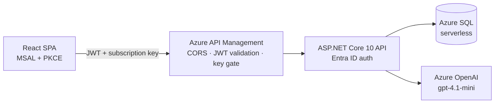

# AI Incident Assistant Lite

A personal reimplementation of an on-call incident triage system, built to demonstrate the full stack behind a production Azure API: OAuth 2.0/OIDC, API Management, and an LLM-powered triage assistant.

## Architecture



**Request path:** browser → APIM (CORS preflight, subscription key, JWT validated at the edge) → App Service (JWT validated again — defense in depth) → Azure SQL / Azure OpenAI.

## Stack

- **API:** ASP.NET Core 10, EF Core, controller + service layering, DTOs in a shared `Metadata` contracts project
- **Auth:** Microsoft Entra ID, OAuth 2.0 authorization code + PKCE, JWT bearer validation (API and gateway, independently)
- **Gateway:** Azure API Management (Consumption), CORS + validate-jwt policies, versioned in `apim/`
- **Data:** Azure SQL Database (serverless, free tier)
- **AI:** Azure OpenAI (Foundry), structured-JSON triage prompt via the Responses API
- **Frontend:** React + TypeScript (Vite), MSAL redirect PKCE flow
- **Infra:** Azure CLI + portal (Day 1–2); IaC/pipeline automation planned for Day 3

## Features

- Full incident CRUD with status/severity filtering
- Entra ID sign-in, token acquisition, silent refresh
- **AI Triage** — one click sends an incident's title/description to Azure OpenAI and returns a suggested severity, category, and troubleshooting steps, with an apply-to-incident action

## Running locally

```bash
# API (needs a local SQL Server — see docker command below)
docker run -e "ACCEPT_EULA=Y" -e "MSSQL_SA_PASSWORD=<pw>" -p 1433:1433 \
  --name sql2025 -d mcr.microsoft.com/mssql/server:2025-latest
cd IncidentAssistant.Api
dotnet ef database update
dotnet run

# Frontend
cd incident-ui
npm install
npm run dev
```

Requires Entra ID app registrations (API + SPA) and an Azure OpenAI deployment — see `apim/README.md` and the build journal (`PROGRESS.md`) for the full setup trail, including every mistake made getting here.

## Notes

This project prioritized understanding every layer by hand — manual Azure CLI/portal provisioning before any automation — documented in `PROGRESS.md`, which reads as a real build journal: decisions, dead ends, and the debugging that got past them.